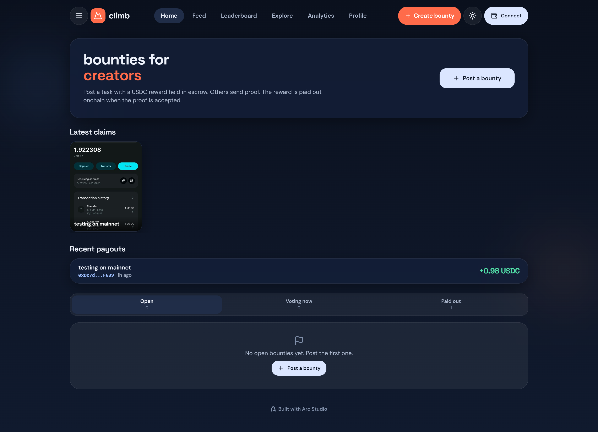
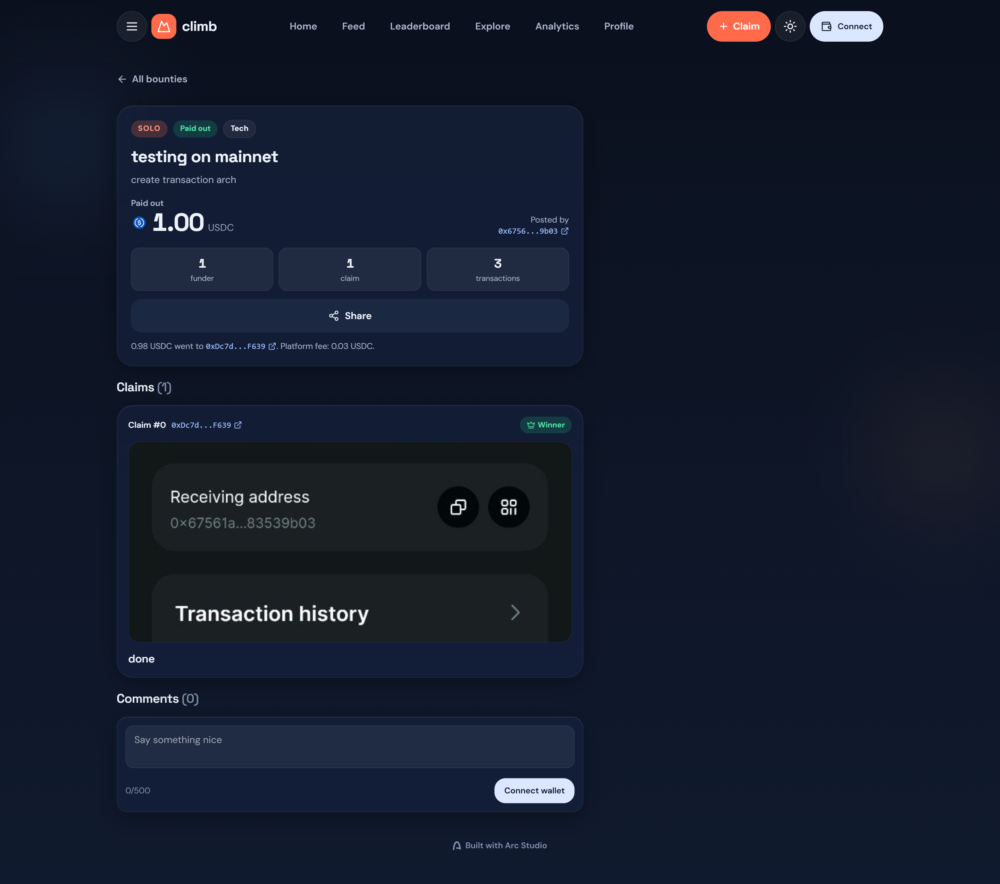

# climb

**Social bounties paid in USDC on Arc.** Post a task with a USDC reward held in escrow, others submit photo proof, and the reward is paid out onchain when the proof is accepted.

Built with [Arc Studio](https://studio.arc.io), live on **Arc mainnet**.



## Links

| | |
|---|---|
| Live app | https://arc-studio-32f9cc86cc0946f989fc38c8.vercel.app |
| Contract (Arc mainnet, verified) | [`0x180055e9f7A109274b595E3C4fFD02F1c116b038`](https://explorer.arc.io/address/0x180055e9f7A109274b595E3C4fFD02F1c116b038) |
| Example payout transaction | [`0xf3776917…b578940`](https://explorer.arc.io/tx/0xf377691747a8bd35ed58c6f790ad5a84a223ea1750ca54361d9112e97b578940) |
| Arc Studio showcase | https://studio.arc.io/share/climb-social-bounty-platform-43xz9qm55p |
| Builder | [@ahmardchain](https://x.com/ahmardchain) |

## Real USDC on mainnet

The first bounty on Arc mainnet ran the full flow through the contract and the app:

1. [`createBounty`](https://explorer.arc.io/tx/0xda8b1aec7be37cb7d3c5e2167117078092e085b20efeb56d3cdb5bb52ddb0403): the creator locked 1 USDC in escrow.
2. [`submitClaim`](https://explorer.arc.io/tx/0x01d8140948452a4489841f0677ac28857821855881667c8d27efa0915d704f66): a second wallet submitted photo proof, stored on IPFS.
3. [`acceptClaim`](https://explorer.arc.io/tx/0xf377691747a8bd35ed58c6f790ad5a84a223ea1750ca54361d9112e97b578940): the creator accepted it. The contract sent 0.975 USDC to the claimant and the 0.025 USDC fee (2.5%) to the treasury in one transaction.



## How it works

**Solo bounties.** The creator funds the reward and picks the winning claim. Accepting a claim pays the claimant immediately.

**Open bounties.** Anyone can add USDC to the reward. The creator nominates a claim, which starts a 48-hour vote. Funders vote yes or no, weighted by how much USDC they put in. A yes majority pays the claimant. Otherwise the bounty reopens.

**Refunds.** The creator can cancel an active bounty, and every funder then pulls back exactly what they put in, with no fee. On open bounties, funders other than the creator can also withdraw at any time outside a vote.

**Fee.** 2.5% of the reward on a completed bounty, taken at payout. Refunds and withdrawals are free.

## Safety by design

- **No admin access to escrow.** The owner can only change the treasury address and the fee, which is capped at 5% in code. There is no function that moves, freezes or redirects escrowed funds.
- **No vote buying.** Contributions and withdrawals are locked while a vote runs, so voting power is fixed for the round.
- **No self-dealing.** Funders cannot claim, claimants cannot fund, and the creator cannot claim their own bounty.
- **Funders always have an exit.** After a failed vote the creator must wait 24 hours before nominating again, and funders can withdraw during that window.
- **Payouts cannot get stuck.** If a transfer to the winner or the treasury fails, the amount is held for that address to withdraw later, and the bounty still settles.
- **Standard protections.** Reentrancy guard and checks-effects-interactions on every function that moves USDC, SafeERC20, and pull-based refunds with no loops over contributors.

The contract is covered by 78 Foundry tests, including fuzz and invariant tests (`contracts/test/`). It has not had a professional audit, so use small amounts.

## Built with Arc Studio

The contract, its tests and the app were all built in Arc Studio: the ClimbEscrow contract and its security review, the Foundry test suite, the React app, IPFS image uploads with wallet signatures and rate limits, and the switch from Arc Testnet to mainnet.

## Features

- Home, Feed, Leaderboard, Explore (search, categories, trending), Profile, Analytics and a How it works guide
- Categories, comments and share links on every bounty
- Claims require an image proof, uploaded to IPFS through Pinata (JPG, PNG, WebP or GIF, up to 10 MB)
- All activity is read from the contract's onchain events, with no backend database
- Light and dark mode, mobile-first with a bottom navigation bar

## Tech stack

- React, Vite, TypeScript, Tailwind CSS
- wagmi, viem, ConnectKit
- Solidity and Foundry (`contracts/`)
- Arc mainnet and Arc Testnet, USDC
- Vercel serverless route for uploads, Pinata (IPFS), Upstash Redis for rate limits

## Development

Prerequisites: [Bun](https://bun.sh), [Foundry](https://getfoundry.sh), and a browser wallet.

Install and run:

```bash
bun install
bun run dev
```

Build and test:

```bash
bun run build
bun run contracts:build
bun run contracts:test
```

### Environment variables

Copy `.env.example` to `.env` and fill it in.

- `VITE_CLIMB_NETWORK`: set to `mainnet` to use Arc mainnet; otherwise the app uses Arc Testnet. Mainnet uses real USDC, see `docs/mainnet-deploy.md`.
- `VITE_CLIMB_ESCROW_ADDRESS`: address of the deployed ClimbEscrow contract.
- `VITE_CLIMB_DEPLOY_BLOCK`: block the contract was deployed at (optional). Lets the app read history without scanning from block 0.
- `PINATA_JWT`: server-side only. Pinata API key (Files: Write) used by the `/api/upload` route to pin claim images. Get one at https://app.pinata.cloud/developers/api-keys. Never prefix it with `VITE_`.
- `UPSTASH_REDIS_REST_URL`, `UPSTASH_REDIS_REST_TOKEN` (or Vercel KV's `KV_REST_API_URL`, `KV_REST_API_TOKEN`): server-side, optional. Shared store for the upload rate limits (10 per wallet and 20 per IP per hour). Without it the limits only hold per server instance.
- `RPC_PROXY_BASE_URL`, `RPC_PROXY_TOKEN`, `RPC_PROXY_CHAINS`: provisioned by Arc Studio (optional outside Arc Studio).

Restart the dev server after changing `.env`.

Image uploads run through `api/upload.ts`, a Vercel serverless route. `bun run dev` serves the same code locally. Uploads need a wallet signature (valid 5 minutes) and are rate limited. A static-only host will not run it, so deploy to Vercel (or another host with serverless routes) and set `PINATA_JWT` there.

### Mainnet deployment

The mainnet contract was deployed with these constructor arguments:

| Argument | Value |
|---|---|
| `usdc_` | `0x3600000000000000000000000000000000000000` |
| `treasury_` | `0x67561a4951B99AFE1018919dd3A3FDE883539b03` |
| `feeBps_` | `250` (2.5%) |
| `owner_` | `0x67561a4951B99AFE1018919dd3A3FDE883539b03` |

Deploy block: `28773343`. Full steps are in `docs/mainnet-deploy.md`.
